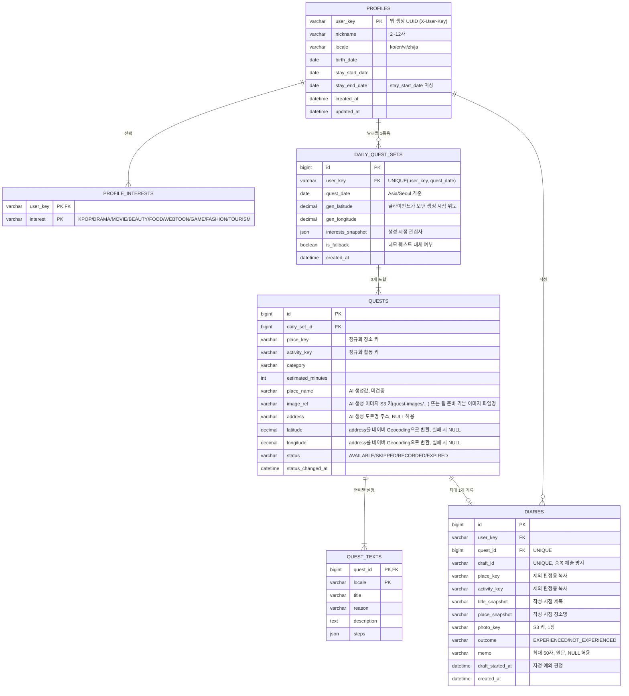

# 동네메이트 ERD

작성일: 2026-11-06 · 기준: 동네메이트 API 명세서(MVP 확정본)

## 다이어그램

## 관계

| 관계 | 카디널리티 | 설명 |
| --- | --- | --- |
| profiles → profile_interests | 1 : 1..N | 관심사 1개 이상 필수 |
| profiles → daily_quest_sets | 1 : 0..N | 사용자·날짜당 1묶음 (UNIQUE) |
| daily_quest_sets → quests | 1 : 3 | 그날 첫 ensure에서 3개 생성, 보충 없음 |
| quests → quest_texts | 1 : 1..N | 생성 언어 1건 + 요청된 언어 번역 캐시 |
| quests → diaries | 1 : 0..1 | 기록하면 1개, 패스·만료면 없음 |
| profiles → diaries | 1 : 0..N | 목록 조회·집계용 |

## 인덱스·제약

| 테이블 | 제약/인덱스 | 목적 |
| --- | --- | --- |
| daily_quest_sets | UNIQUE(user_key, quest_date) | 같은 날 묶음 중복 생성 방지 |
| quests | INDEX(daily_set_id, status) | 오늘 남은 퀘스트 조회 |
| diaries | UNIQUE(quest_id) | 퀘스트당 일기 1개 |
| diaries | UNIQUE(draft_id) | 중복 제출 시 기존 일기 반환 |
| diaries | INDEX(user_key, created_at) | 목록 최신순 조회 |
| diaries | INDEX(user_key, outcome, place_key, activity_key) | 경험한 장소+활동 제외 목록 조회 |

## 설계 메모

- 퀘스트는 사용자별로 생성되므로 별도 UserQuest 없이 `quests.status`로 상태를 관리한다.
- `EXPIRED`는 배치로 바꾸지 않고 `quest_date < 오늘`이면 만료로 판정해도 된다. 이 경우 status 컬럼에는 AVAILABLE이 남는다.
- 관심사는 API 명세서 초안의 `profiles.interests` 컬럼 대신 `profile_interests` 테이블로 분리했다. JSON 컬럼으로 두고 싶다면 이 테이블을 빼면 된다.
- diaries의 `place_key`·`activity_key`·스냅샷은 quests에서 복사해 둔다. 제외 목록 조회를 조인 없이 하고, 작성 당시 표기를 보존하기 위해서다.
- 데모 퀘스트는 별도 테이블 없이 코드/설정 파일에 두고, 대체 시 quests에 복사 저장한다.
- quests의 latitude·longitude는 퀘스트 생성 시 한 번만 변환해 저장한다(상세 조회 때 외부 호출 없음).
